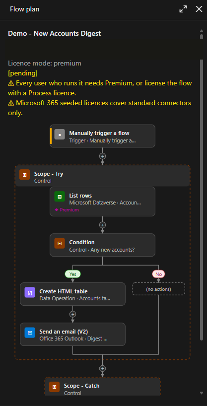

# flow-plan

A Claude Code mod that makes Claude show you the design of a Power Automate cloud flow, and wait for your approval, before it builds anything.

> **Prerequisite:** flow-plan is built to work with Microsoft's **power-automate** plugin for Claude Code. That plugin does the building; flow-plan decides when it's allowed to. Install and set it up first:
>
> ```
> /plugin marketplace add microsoft/power-platform-skills
> /plugin install power-automate@power-platform-skills
> ```
>
> Then run `/power-automate:setup` and make sure it can see your environments.



## The problem

Ask Claude Code to build a flow and it goes straight from your request to a real flow in your environment. You see the design after it exists. If it uses a premium connector your users aren't licensed for, puts a Terminate inside an Apply to each, or has no error handling, you find out when you open the designer or when a run fails.

flow-plan puts a design review in between. Claude proposes the flow as a plan in a sidebar, the plan is checked for licensing and design problems, and the build tools stay blocked until you approve **that** flow's plan.

## Features

- **Plan before build.** Claude proposes every new flow, or change to an existing one, as a plan: trigger, actions with their connectors, Condition/Switch/loop branches, run-after and the key inputs.
- **A designer-style sidebar.** In Claude Code Desktop, VS Code and mobile the plan is drawn as one picture that looks like the Power Automate designer: cards with connector chips, side-by-side Condition branches that rejoin, and dashed containers for Scope, Apply to each and Do until. The terminal gets a text version of the same plan. A **cards** style is also available.
- **Approval per flow.** Each plan names the one flow it's for: a new flow by name, or an existing flow by ID. Approving it allows builds for that flow only. Every other create, update, edit or copy is blocked with a reason Claude can act on.
- **Single-use create approval.** Once a new flow is created, the approval is used up. A second create with the same name needs a new plan. Updates to the flow just created stay allowed.
- **Flow link after the build.** After a successful create, update or edit, the pane and Claude both get the maker-portal link to the flow's details page.
- **Approve and Reject that talk to Claude.** Approve tells Claude it can build now. Reject takes an optional reason, and Claude gets it, so it can revise the plan.
- **Licensing badges.** Connector tiers come from the Power Automate plugin's connector list, not from Claude's memory. Premium and custom connectors get a badge, and the plan shows which licence its trigger kind needs.
- **Standard licence mode.** Switch to standard and any premium or custom step blocks Approve until you change the design or the mode.
- **Design checks.** Eight rules run on every plan. **Invalid** findings must be fixed and re-proposed. **Warnings** block Approve until you acknowledge them.
- **Node details.** Data actions carry their inputs and the target site, list or table. HTTP request triggers say who can call them. A Details button shows it all in the pane.
- **Works in Plan mode.** Proposing a plan writes nothing outside the session, so it's allowed in Claude's Plan mode. Building still isn't.
- **Tells Claude when you can't see it.** If the sidebar isn't on screen, the tool result tells Claude to ask you to run `/flow-plan`.

### The design checks

| Rule | Severity | What it catches |
|---|---|---|
| `PA-TERMINATE-IN-LOOP` | Invalid | Terminate inside Apply to each or Do until (the platform doesn't allow it) |
| `PA-SINGLE-RECORD-LOOP` | Warning | A loop over a top-1 list or a single record. Use `first()` instead |
| `PA-NESTED-LOOP` | Warning | A loop inside a loop |
| `PA-NO-TRY-CATCH` | Warning | No Try scope with a Catch scope |
| `PA-CATCH-RUNAFTER` | Warning | A Catch scope that doesn't run after failure or timeout |
| `PA-LIST-NO-FILTER` | Warning | List rows or Get items with no filter or select |
| `PA-TRIGGER-NO-FILTER` | Warning | An automated Dataverse or SharePoint trigger with no filter or condition |
| `PA-CHILD-NO-RESPOND` | Warning | A path through a `[child]` flow that doesn't end with Respond |

**These are my rules, not Microsoft's.** They're the standards I hold my own flows to. For best results, define your own: the rules are plain functions in `hooks/lib/lint.ts`, so change them, remove them or add your own. I'll publish more on the standards behind them later.

## How to use it

Once installed, you don't need to do anything different. Ask Claude for a flow as you normally would:

```
Build a flow that posts a Teams message when an item is created in the Requests list.
```

Claude proposes the plan, the sidebar opens with it, and Claude stops. Review it, then click **Approve** or **Reject**.

### Commands

| Command | What it does |
|---|---|
| `/flow-plan` | Opens the plan pane, focused |
| `/flow-plan-style designer` or `cards` | Switches how the plan is drawn |
| `/flow-plan-licence premium` or `standard` | Sets the licence mode for this session (default `premium`) |

### Pane buttons

| Button | What it does |
|---|---|
| **Approve** | Approves this version of the plan and tells Claude to build. Dimmed as **Approve (blocked)** while there are unfixed findings |
| **Acknowledge warnings (n)** | Accepts the plan's warnings so it can be approved |
| **Reject** | Opens a reason box. Press Enter to send it to Claude, or press Reject again to cancel |
| **Details** | Shows each node's inputs, expressions, variables and notes |
| **Style** | Switches between designer and cards |
| **Licence** | Switches between premium and standard mode |
| **Open in Power Automate** | Appears after a build, linking to the flow's details page |

## Requirements

- **Claude Code 2.1.308 or later**, with mods support. Built and tested on 2.1.308, in the terminal and Claude Code Desktop. Earlier versions can't tell the mod that its connector lookup is read-only, so in auto mode the badges show `?`.
- **Microsoft's power-automate plugin**, installed and signed in (see the prerequisite above). flow-plan gates its `create_flow`, `update_flow`, `edit_flow` and `copy_flow` tools, and uses its `list_connectors` tool to look up connector tiers. flow-plan lets its own `list_connectors` lookup run without a prompt in every permission mode, auto mode included. It does this only for that one read-only tool, and your own permission rules still apply. You don't need to add a rule.
- **Azure CLI**, signed in with `az login`. The power-automate plugin uses it to authenticate.
- **Access to a Power Automate environment** where you can create flows. Use a dev environment while you try it out.

### What's in the mod

| File | Purpose |
|---|---|
| `hooks/hooks.json` | Points Claude Code at the mod |
| `hooks/flow-plan.tsx` | The mod: the plan tool, the prompt rule, the build gate, the commands and the pane |
| `hooks/lib/plans.ts` | Plan storage per flow, versions, approval and the gate's decisions |
| `hooks/lib/tiers.ts` | Connector tier lookup and matching |
| `hooks/lib/licensing.ts` | Licence badges, banners and the standard-mode finding |
| `hooks/lib/lint.ts` | The design checks |
| `hooks/lib/flow-svg.ts` | The designer picture for Desktop, VS Code and mobile |
| `types/index.d.ts` | Types for plans and the mod's state |
| `tests/flow-plan.test.ts` | 71 unit tests |

## Status

Version 0.8.0. **71 unit tests pass** (`claude plugin test .`). Live-checked in the terminal and Claude Code Desktop: plan before build, the per-flow gate, single-use create approval with the flow link, Reject with a reason, Plan mode, node details, the licence badges and banners in auto mode, and standard mode blocking Approve.

Not yet checked live: the premium badge on an HTTP request trigger, the Details and Style buttons, and the designer picture in the light theme.

## Known limitations

- **The gate only covers the power-automate plugin's build tools.** Claude could still create a flow another way, for example with PAC CLI, a direct call to the Flow API or a write to the Dataverse workflow table.
- **Approval lasts for the session.** A new session needs a new plan and a new approval.
- **Licence mode resets to premium** in each new session.
- **`/flow-plan <description>` probably doesn't send its description to Claude.** Claude Code refuses a prompt submitted from a command handler. Ask for the flow in a normal message instead.
- **Trigger kind is Claude's choice.** Whether an HTTP-triggered flow counts as automated or instant decides which licence banner shows, and that isn't confirmed.
- **"When an HTTP request is received" counts as premium** because the Power Automate designer labels it Premium. The Microsoft Learn pages I checked don't state its tier.
- **Licensing banners ignore in-context exemptions,** such as a flow covered by a Power Apps or Dynamics 365 licence.
- **Unknown tiers** (a connector the lookup can't match) show `?` and neither block nor add a banner.
- **`copy_flow`** is gated, but gets no flow link and isn't marked as built.
- **Very large plans** fall back to the text drawing when the picture would be too big for the pane.

## Future features

- **Gate the other build routes:** PAC CLI, the Flow API and Dataverse workflow writes.
- **Solution and ALM section:** connection references and environment variables in the plan, with a finding for a connector that has no connection reference.
- **Diff against the live flow:** for an update, show what changes compared with the flow as it is now.
- **Build drift check:** compare what was built with what was approved, and block publishing until you acknowledge any difference.
- **Run-history mode:** a status badge and duration on each card from a flow run.
- **Real connector icons** in place of the glyph chips.
- **Hover tooltips** with the full text of names cut short on the cards.

## Install it, or build your own

**Install this plugin:**

```
/plugin marketplace add madmat01/flow-plan
/plugin install flow-plan@flow-plan
```

**Or build your own.** [PROMPT.md](PROMPT.md) has the prompts I'd give Claude Code to build this mod from scratch: a core prompt for the plan, the sidebar and the gate, then add-ons one at a time. Some people prefer this for security and control: you read every line Claude writes, and you can change the rules and the behaviour to suit how you work.

## How it's built

flow-plan is a Claude Code **mod**: TypeScript event handlers that run inside Claude Code. See the [Mods overview](https://code.claude.com/docs/en/plugins/mods/overview). It:

- **registers a tool,** `propose_flow_plan`, that Claude calls with the plan as structured data;
- **adds a rule to Claude's prompt** to always propose before building;
- **hooks the power-automate plugin's build tools,** and lets a call through only when its arguments match an approved plan;
- **draws a pane** beside the transcript with the plan and the buttons;
- **keeps its state per session,** so nothing is stored outside the session.

The pane is drawn by the mod's own code, not by Claude, so a plan costs Claude about the same tokens however it's displayed.

## Licence

[MIT](LICENSE)
